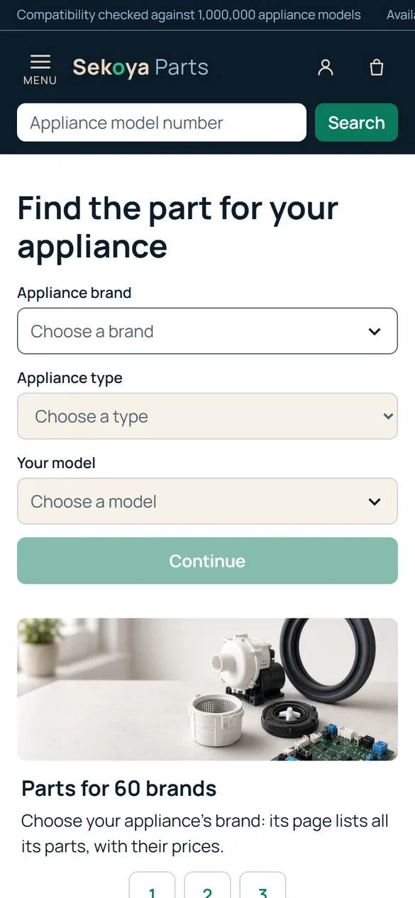
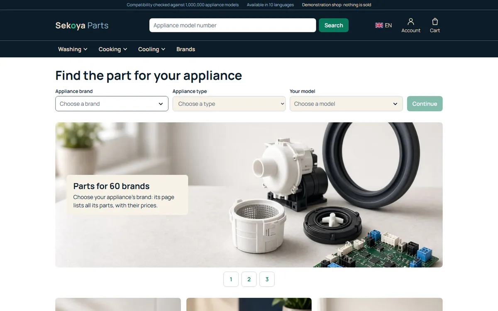
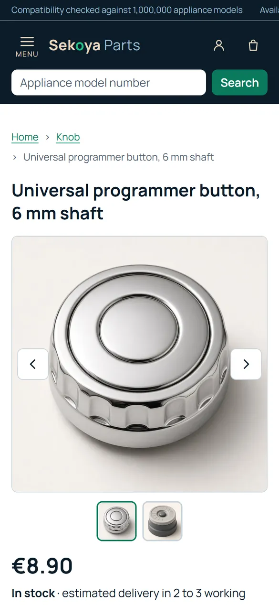
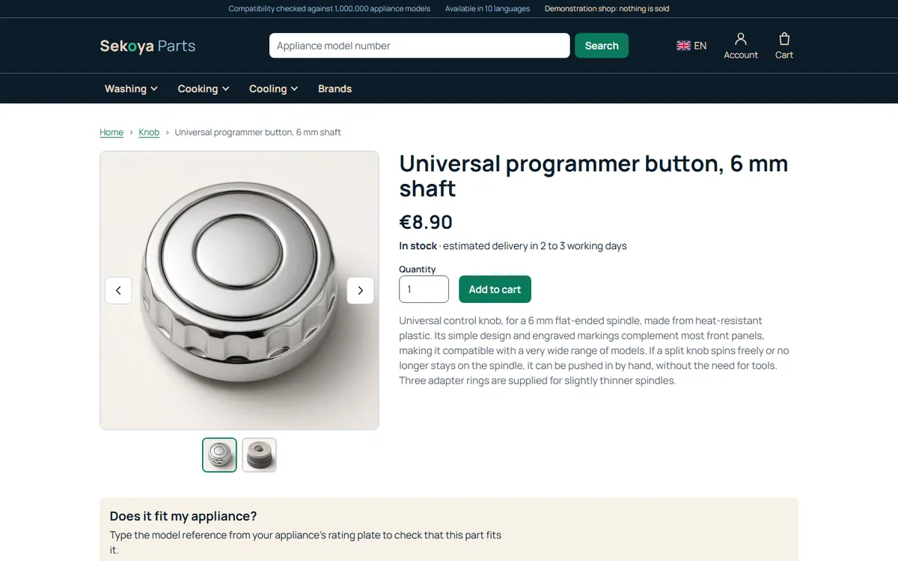
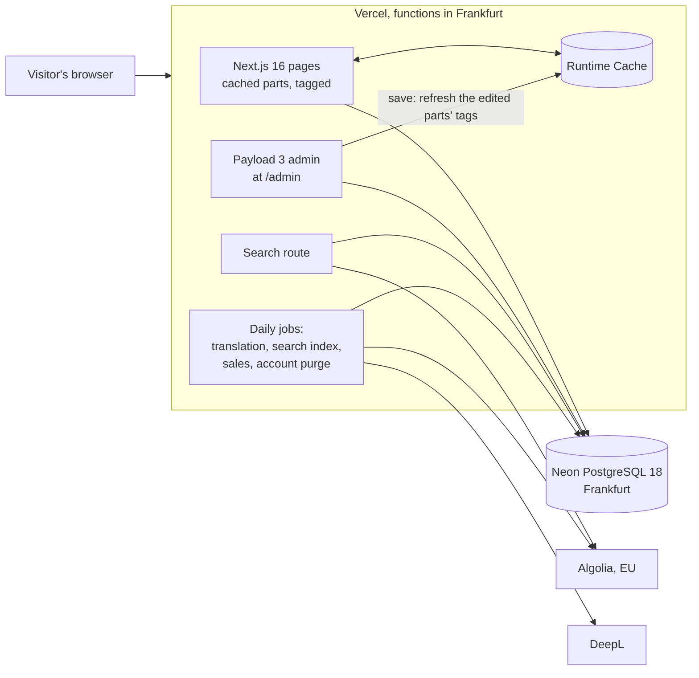

# Sekoya Parts

A spare-parts e-commerce site built to show that a very large catalog can stay fast and cheap: 100,000 products, 1,000,000 appliance models and ten languages, its measured pages scoring 96 to 100 on Lighthouse's mobile test, on free hosting plans, with no third-party script.

**Live:** [sekoya-parts.vercel.app](https://sekoya-parts.vercel.app). It is a portfolio project and a demonstration shop: the catalog, a cart, customer accounts and a mock checkout work, but nothing is paid, no email is sent and no order is delivered. Twelve showcase products, one per category, have real descriptions; the others have generated names and placeholder text.

| Phone | Desktop |
| --- | --- |
|  |  |
|  |  |

The screenshots show the English pages of production on 2026-11-17. The product pictures were generated by the owner ([source note](assets/images/README.md)).

## What it demonstrates

- **Scale.** 100,000 products, 60 brands, 1,000,000 appliance models and 1,451,992 compatibility links, in a 273 MB PostgreSQL database. A seeded generator loads it with `COPY`, in 33 seconds on its first full load, and gives the same catalog every time ([ADR 0007](docs/adr/0007-catalog-data-model.md)).
- **A product that fits a million appliances.** Its page lists the 1,000 most popular models as plain links, a number set by measurement, and the rest on numbered pages of 500. Each page reads its ranks straight from an index with no `OFFSET`, so the last page is as fast as the first. A test fails if a product page reaches Google's 2 MB crawl limit in any language ([ADR 0009](docs/adr/0009-compatible-references.md), [experiment 2](docs/experiments/0002-reference-list.md)).
- **Partial refresh.** Each part of a page (price, description, reference list, listing) is its own cached component with Next.js 16's Cache Components, tagged on its own. Saving a price in the admin refreshes the price tag only: the next visit shows the new price and reuses the description and the reference list from the cache. Sale prices start and end at their dates without a save ([ADR 0008](docs/adr/0008-caching-and-partial-refresh.md), [experiment 1](docs/experiments/0001-partial-refresh.md)).
- **Ten languages** on one domain, with translated addresses (`/fr/refrigerateur`, `/en/fridge`), `hreflang` tags, and the bare domain sending each visitor to the language they last picked, else their browser's. A daily job translates new or changed French text of the showcase products with DeepL; a translation memory means each text is paid for once, so ten languages cost 91,220 of DeepL's 1,000,000 free characters ([ADR 0011](docs/adr/0011-languages-and-seo.md)).
- **Search.** One search box: an exact appliance model reference leads straight to its page, from PostgreSQL; anything else lists matching models, then parts found by Algolia in the visitor's language. Queries go through the site's own server route, so the browser runs no search code and never sees a key ([ADR 0010](docs/adr/0010-search.md), [experiment 3](docs/experiments/0003-search-latency.md)).
- **Performance as a merge gate.** Lighthouse, with PageSpeed Insights' mobile settings, measures every pull request's preview: the median of three runs after a warm-up must reach 90 in performance and 95 in accessibility, or the pull request cannot merge. The same measurement runs again on production after each merge. It measures the home, category and product templates today; the other templates are paused in the workflow, and an end-to-end test still checks their addresses ([ADR 0004](docs/adr/0004-testing-and-ci.md)).
- **A demo shop that keeps the catalog static.** The cart is in a cookie and the header's count comes from a small browser component, so no catalog page depends on the visitor. Shop actions are forms that work without JavaScript. Customer accounts store a username, no email address, and are deleted 30 days after the last sign-in ([ADR 0013](docs/adr/0013-visitor-state.md), [ADR 0014](docs/adr/0014-customer-accounts.md)).
- **Privacy.** No analytics, chat widget, cookie banner or any other third-party script, and Payload's telemetry is off.

## Key figures

| Figure | Value | Source |
| --- | --- | --- |
| Lighthouse mobile performance, median, 2026-11-17 | Home 96, category 100, product 98; accessibility 100 | The Lighthouse check of pull request #203 |
| Tests on every pull request, 2026-11-17 | 817 unit tests, 377 end-to-end tests, against a production build | Local runs of issue #185 |
| Price edit to the next visit | Only the price re-rendered; 0.19 s on a page rendered on demand | [Experiment 1](docs/experiments/0001-partial-refresh.md) |
| First and last of 2,000 reference pages | At most 11.6 ms and 1.9 ms warm, both from the index | [Experiment 2](docs/experiments/0002-reference-list.md) |
| A search and its results page, warm, seen from France | About 250 to 400 ms | [Experiment 3](docs/experiments/0003-search-latency.md) |
| DeepL characters spent for ten languages, 2026-11-17 | 91,220 of 1,000,000 | [Roadmap](docs/roadmap.md) |
| Hosting cost | 0 €: Vercel Hobby, Neon, Algolia and DeepL free plans | [ADR 0002](docs/adr/0002-hosting-and-environments.md) |

## Architecture

Every pull request runs lint, type checks, Markdown lint, the unit tests and the end-to-end tests against a production build on a fresh PostgreSQL 18 database, then Lighthouse on its Vercel preview. All are required on `main`, and none is retried: a flaky test is fixed at its cause. A pull request that changes only Markdown skips the heavy checks.

## How it is built

- **Decisions before code.** Each significant technical choice is an [Architecture Decision Record](docs/adr/README.md) (ADR) with the options considered and what each costs; nothing is implemented before the owner accepts it. Fourteen ADRs are accepted.
- **Measured, not assumed.** Where the documentation did not settle a question, an experiment measured it on the real platform: [partial refresh](docs/experiments/0001-partial-refresh.md), [the size of the reference list](docs/experiments/0002-reference-list.md) and [search latency](docs/experiments/0003-search-latency.md).
- **One path for every change:** an issue with acceptance criteria, a branch, a pull request, the required checks, then the owner's go and a squash merge. The [roadmap](docs/roadmap.md) sums up the phases and the [board](https://github.com/users/sekoya-solutions/projects/3) tracks each issue.
- **AI agents, steered by a tech lead.** The owner, a tech lead with over 15 years of experience, decides and reviews; AI coding agents write the code and the documentation under the standing rules in [AGENTS.md](AGENTS.md).

## Stack

Next.js 16 with the App Router and Cache Components, React 19, TypeScript 7, Node 26, Payload 3, PostgreSQL 18 on Neon, Algolia, DeepL, Tailwind CSS 4, sharp, Biome, Vitest, Playwright and Lighthouse CI, on Vercel. The [ADR index](docs/adr/README.md) gives the reason for each.

## Running the site locally

`npm run dev` first applies any pending migration to the database `.env.local` names, the Neon `dev` branch, then starts the development server; a failed migration stops it before the server starts. Vercel's Preview and Production builds migrate the `preview` branch and `main` the same way, so each database follows the schema of the code that uses it.

## Running the unit tests locally

`npm run test:local` runs the unit tests as CI's "Generator and tests" job does, on a throwaway PostgreSQL 18 database: migrations, the small catalog with seed 1, then Vitest. Pass Vitest's arguments after `--`, for example `npm run test:local -- tests/cart.test.ts`. A full run takes about 50 s on the owner's machine: 38 to 48 s for the 817 tests in the first runs, about 10 s of them in Vitest.

- **Tools:** PostgreSQL 18.6 in `.tools/pgsql`, as for the end-to-end tests below; the command names it when it is missing and downloads nothing itself.
- **Isolation:** the same as the end-to-end tests below, with its own cluster folder and port, so the two commands can run at the same time. The database tests that write the whole catalog or a user run here as in CI, and no test sends anything to DeepL or Algolia.
- `npm test` still runs Vitest against the database `.env.local` names, the Neon `dev` branch, and skips those database tests.

## Running the end-to-end tests locally

`npm run test:e2e:local` runs the end-to-end tests as CI's "End-to-end tests" job does, on a throwaway PostgreSQL 18 database: migrations, the small catalog with seed 1, a production build, then Playwright. Pass Playwright's arguments after `--`, for example `npm run test:e2e:local -- e2e/intro.spec.ts`.

- **Tools,** downloaded once into the git-ignored `.tools/` folder; the command names any that is missing and downloads nothing itself:
  - PostgreSQL 18.6 in `.tools/pgsql`: EDB's `postgresql-18.6-1-windows-x64-binaries.zip` from `get.enterprisedb.com`, unpacked so that `.tools/pgsql/bin` holds `pg_ctl`;
  - Chrome Headless Shell in `.tools/ms-playwright`: `PLAYWRIGHT_BROWSERS_PATH=.tools/ms-playwright npx playwright install --only-shell chromium`.
- **Connections:** the cluster allows 10 connections per CPU plus 20, at least PostgreSQL's default of 100: the production build prerenders in up to one worker per CPU, each with its own pool of 10 (issue #156).
- **Isolation:** the database is a new cluster on a free local port, with a password generated for the run, deleted when the run ends, fails or is interrupted. Every variable `.env.example` names is set by the command itself, so `.env.local`, the Neon branches and the Algolia, DeepL and Vercel keys are never used.
- **Windows:** the command makes the `.next` folder case-sensitive, as on Linux, before building: otherwise `/FR` and `/fr` share one prerendered file.

## License

All rights reserved; see [LICENSE](LICENSE).
